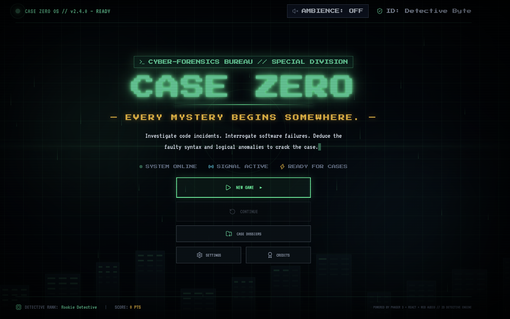
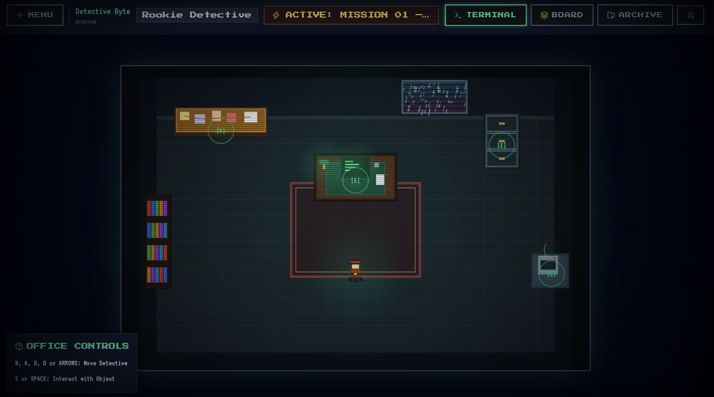
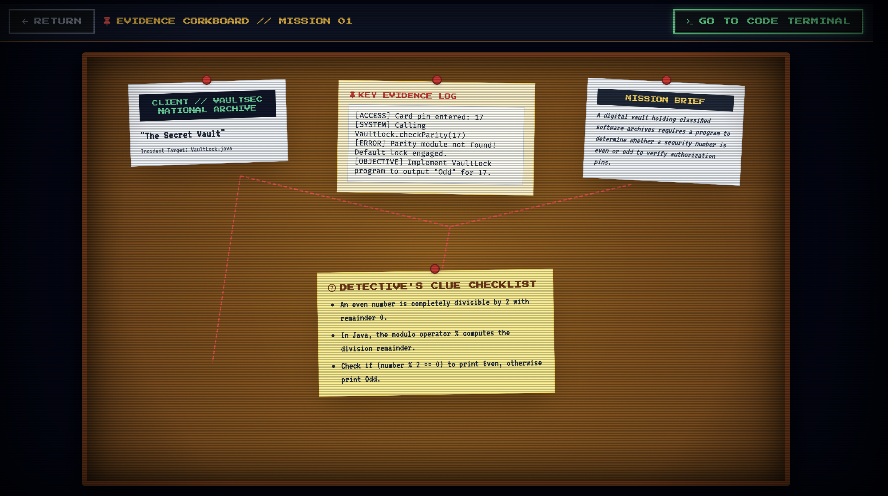
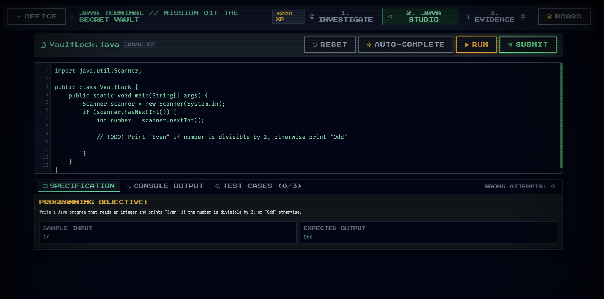

# CASE ZERO

### Every Mystery Begins Somewhere.

**CASE ZERO** is a 2D detective-themed Java coding game where players investigate mysterious incidents, uncover clues, and solve programming challenges to crack each case.

Instead of simply fixing bugs, players step into the role of an investigator, using logical thinking and Java programming skills to solve increasingly challenging missions.

## Game Screenshots

### Main Menu


### Detective Office


### Java Clues


### Java Mission


## Features

- **20 Java Missions** — Progress through coding challenges ranging from beginner to advanced concepts.
- **Interactive Detective Environment** — Explore a dark, atmospheric investigation office.
- **Real Java Code Execution** — Compile and execute submitted Java code.
- **Automated Test Cases** — Validate solutions against expected outputs.
- **Progressive Difficulty** — Learn Java concepts through increasingly challenging cases.
- **Hints and Feedback** — Get guidance while solving missions.
- **Progress Tracking** — Track completed cases and your score.
- **Ambient Audio** — Rain and subtle piano-inspired background sounds.

## Java Concepts Covered

The missions introduce and reinforce:

- Variables and input/output
- Conditional statements and loops
- Strings and arrays
- Searching and sorting
- Object-oriented programming
- Encapsulation, inheritance and polymorphism
- Recursion
- Exception handling
- Collections and HashMaps
- Multithreading

## Tech Stack

| Technology | Purpose |
|---|---|
| React | User interface |
| TypeScript | Application logic |
| Vite | Development and build tooling |
| Phaser 3 | 2D game development |
| Java | Programming challenges |
| Node.js + Express | Java execution API |
| CSS | Styling and animations |
| LocalStorage | Local progress persistence |

## Getting Started

### Prerequisites

Make sure you have installed:

- Node.js and npm
- Java JDK
- Git

Check your installations:

```bash
node -v
npm -v
java -version
javac -version
```

### 1. Clone the Repository

```bash
git clone https://github.com/TejshreeParmar/case-zero.git
```

### 2. Open the Project

```bash
cd case-zero
```

### 3. Install Dependencies

```bash
npm install
```

### 4. Start the Java Execution Server

Open a terminal and run:

```bash
npm run dev:server
```

### 5. Start the Frontend

Open a second terminal in the project folder:

```bash
npm run dev
```

### 6. Play the Game

Open the local URL printed by Vite in your browser, usually:

```text
http://localhost:5173
```

## Project Structure

```text
case-zero/
├── public/
├── server/
│   ├── index.ts
│   ├── javaSandbox.ts
│   └── missionTestSuites.ts
├── src/
│   ├── components/
│   ├── game/
│   ├── utils/
│   └── ...
├── index.html
├── package.json
├── vite.config.ts
└── README.md
```

*The structure above is a simplified overview.*

## Security Notice

The Java execution server is currently intended for local development and testing. Its current restrictions are not a substitute for a hardened, isolated execution environment. Do not expose it to public users without implementing proper sandboxing and resource limits.

## Project Goal

CASE ZERO aims to make learning Java more interactive by combining programming challenges with detective-style investigation and game progression.

**Think logically. Follow the evidence. Crack the case.**

---

*CASE ZERO — Every Mystery Begins Somewhere.*